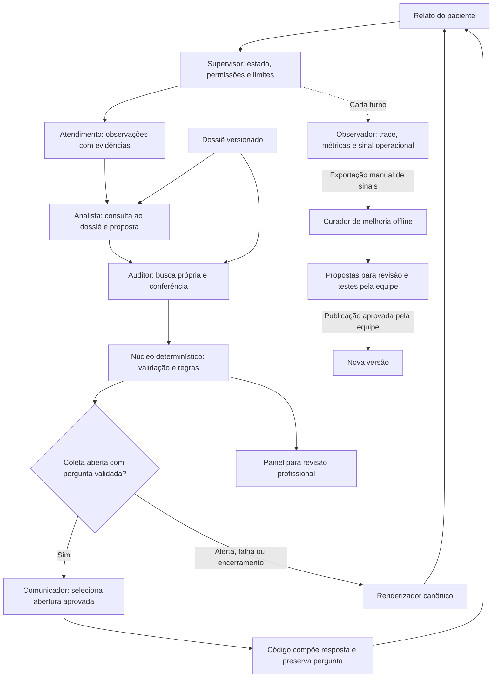

# HealthFlow | Agentes de IA

**AKCIT Camp Centro-Oeste 2026 | Equipe HealthFlow | Documentação de 24/10/2026**

O HealthFlow é um assistente experimental de pré-triagem que organiza o relato
do paciente, consulta um dossiê versionado e entrega uma proposta rastreável para
revisão profissional. Esta documentação descreve os **inputs, a lógica e os
outputs dos agentes**, conforme a implementação local conferida nesta data.

A arquitetura reúne **cinco papéis de IA**: Atendimento, Analista, Auditor,
Comunicador e Curador de melhoria. Os três primeiros participam do núcleo da
coleta; o Comunicador atua quando há uma pergunta validada; o Curador funciona
fora da conversa, mediante acionamento separado pela equipe.

O supervisor, o núcleo de regras e o observador de logs são serviços em código.
Eles não são agentes adicionais de LLM. O modelo padrão configurado é
`gemini-2.5-flash`, compartilhado pelos papéis; isso não implica independência
estatística entre os agentes nem comprova acurácia clínica.

## Visão geral do fluxo



O paciente fornece dados. Os agentes propõem ações dentro de permissões
restritas. O código valida ferramentas, evidências, regras e composição da
resposta. A avaliação clínica e a decisão de encaminhamento dependem de um
profissional habilitado.

## Inputs: o que entra

| Entrada | Origem e finalidade |
| --- | --- |
| Mensagens originais | Relato textual do episódio, preservado com identificadores para conferir citações. |
| Histórico e estado anterior | Perguntas realmente feitas, observações e informações já sustentadas. |
| Contexto documental | Dossiê HealthFlow com 357 fichas e 30 árvores versionadas, fontes e hash canônico. O dossiê permanece `DRAFT_UNREVIEWED`. |
| Contexto do adaptador | Episódio, revisão esperada, autenticação e escopo de tenant/unidade. |
| Configuração operacional | Modelo, ferramentas permitidas, prazos e orçamentos de execução. |
| Sinais de melhoria | Somente para o Curador: métricas operacionais tipadas, exportadas pela equipe fora do atendimento. |

No painel, um turno chega ao endpoint
`POST /v1/clinical/episodes/{episode_id}/turns` com `text`, `message_id` e
`expected_revision`. O cliente não envia fatos clínicos ou veredictos para serem
aceitos como verdade. A aplicação verifica permissão, idempotência e concorrência.

O WhatsApp usa o gateway WAHA no protótipo. Os adaptadores do WhatsApp e do
painel chamam o mesmo serviço de conversa; o canal não cria uma lógica clínica
independente.

## Lógica: responsabilidades e ferramentas

| Papel de IA | O que recebe | Ferramentas permitidas | O que entrega |
| --- | --- | --- | --- |
| **Atendimento** | Mensagens e contexto do episódio; pendências disponíveis. | `consultar_pendencias`, `propor_observacao`, `pedir_esclarecimento`, `solicitar_analise` | Observações propostas com mensagem de origem e citação literal; sugestões de esclarecimento. |
| **Analista** | Relato, observações e acesso de consulta ao dossiê. | `buscar_fichas`, `consultar_criterios_excecoes`, `solicitar_complemento`, `submeter_proposta_ao_nucleo` | Proposta de fatos, perguntas e encaminhamento, vinculada ao material consultado. |
| **Auditor** | Primeiro, mensagens originais e histórico; só depois da busca própria, a proposta a conferir. | `recuperar_contexto`, `buscar_criterios_omitidos`, `conferir_citacoes`, `registrar_divergencia`, `solicitar_revisao_humana`, `concluir_auditoria` | Conferência das evidências, divergências, pedidos de revisão e avaliação documental da proposta. |
| **Comunicador** | Metadados operacionais e catálogo de aberturas; não recebe a conversa clínica. | `selecionar_acolhimento` | Uma abertura aprovada, concatenada por código à pergunta preservada. |
| **Curador de melhoria** | De 1 a 200 sinais operacionais tipados, sem conversas ou prontuários. | `consultar_indicadores`, `propor_experimento`, `concluir_curadoria` | Experimentos permitidos e sustentados pelos sinais, pendentes de revisão humana. |

### Sequência de um turno

1. **Receber e contextualizar.** O adaptador verifica o acesso, recupera o
   episódio e entrega as mensagens ao supervisor.
2. **Estruturar o relato.** O Atendimento propõe observações com fonte literal;
   pode consultar pendências e sugerir esclarecimento. Não publica uma resposta
   clínica livre.
3. **Consultar antes de propor.** O Analista busca fichas e lê critérios e
   exceções antes de submeter uma proposta. Recuperar texto do dossiê é uma
   ferramenta explícita; não se presume que o modelo já conheça esse conteúdo.
4. **Conferir a partir das fontes.** O Auditor inicia sem a proposta do Analista
   e sem o resumo do Atendimento. Precisa realizar uma busca própria antes de
   conhecer a proposta por `conferir_citacoes`. Essa separação procura reduzir
   dependência do resumo, sem garantir independência entre os modelos.
5. **Validar em código.** Citações inexistentes e ferramentas fora do papel são
   recusadas. Auditoria ausente não equivale a aprovação. Divergências materiais
   exigem revisão humana; não se resolve uma dúvida por votação de agentes.
6. **Aplicar regras e compor a saída.** O núcleo determina a pergunta ou o
   encerramento operacional. Havendo coleta aberta e pergunta validada, o
   Comunicador seleciona uma abertura. O código mantém integralmente a pergunta.
   Alertas, falhas e encerramentos seguem o renderizador canônico.
7. **Registrar e disponibilizar.** A aplicação gera metadados de execução,
   observabilidade e sinal de melhoria. Os adaptadores mantêm o snapshot do
   episódio e a proposta fica disponível para revisão profissional no painel.

### Autonomia delimitada

O Gemini escolhe ferramentas e argumentos dentro de cada papel. A aplicação
executa a ferramenta manualmente, valida os argumentos e devolve o resultado
para a próxima decisão. O SDK não recebe execução automática irrestrita.

Há limites de chamadas, tempo e tokens. Ferramentas terminais precisam ser
chamadas sozinhas, depois de o agente receber os resultados das consultas.
Argumentos inválidos, ferramentas de outro papel e repetições são tratados como
recusas ou falhas explícitas.

O Comunicador escolhe entre `DIRETO`, `ACOLHER`, `EXPLICAR_COLETA` e `AGRADECER`.
Não reescreve sintomas, perguntas, alertas ou orientações. Se falhar, a pergunta
canônica é preservada. Aberturas repetidas são suprimidas.

## Outputs: o que sai

| Saída | Significado |
| --- | --- |
| `reply` | Pergunta validada ou mensagem canônica de alerta relatado, informação insuficiente ou falha técnica. |
| `assessment` | Proposta estruturada, estado da coleta, evidências, pendências e indicação de revisão profissional. |
| `episode_state` | Estado versionado do episódio, preservado para continuidade e revisão. |
| `extracted` | Observações e propostas da extração, com seu estado técnico e referências. |
| `usage` | Contagem de tokens de entrada e saída da execução do atendimento, incluindo o Comunicador quando acionado. |
| `assessment.agent_execution` | Modelo, ferramentas, recusas, uso e divergências do núcleo de agentes (`healthflow-agents-v1`). |
| `assessment.communication_execution` | Estado e abertura selecionada pelo Comunicador. |
| `assessment.operational_trace` | Etapas, tempos e metadados operacionais; sem texto clínico (`healthflow-specialists-v2`). |
| `assessment.learning_signal` | Sinal operacional para curadoria posterior, sem falas, nomes, telefones ou identificador do episódio. |

Um fato pode ser `AFIRMADO`, `NEGADO`, `DESCONHECIDO` ou `CONTRADITORIO`.
O processamento pode terminar `OK`, `PARTIAL` ou `FAILED`. Um erro técnico não
transforma dados desconhecidos em negativas nem comprova que um caso é de baixo
risco. Informações anteriores sustentadas e alertas com suporte são preservados.

No estado atual, o núcleo mantém:

```json
{
  "human_review_required": true,
  "evidence_semantics_verified": false,
  "confirmed_destination_id": null,
  "dispatch_decision": null
}
```

Uma proposta de encaminhamento não confirma diagnóstico, unidade, vaga,
despacho ou atendimento. A conferência documental feita pelo software não
equivale a validação clínica independente.

## Melhoria fora da conversa

O Curador consulta contagens e categorias de problemas, como falha técnica,
ferramenta recusada, auditoria incompleta, falha de comunicação ou alto uso de
tokens. Propõe somente experimentos de um catálogo permitido, com referências
existentes nos sinais recebidos.

As propostas permanecem `PENDING_HUMAN_REVIEW`, com `changes_applied: false` e
`clinical_validation: false`. O ciclo é: exportação dos sinais pela equipe,
curadoria, revisão, implementação, testes e publicação de uma nova versão.
Não há treinamento online automático com relatos dos pacientes, nem alteração
autônoma de dossiê, prompts, código ou pesos.

## Rastreabilidade, privacidade e falhas

- O histórico clínico e suas citações permanecem no contexto autorizado do
  episódio. O trace operacional não duplica o texto do paciente.
- Eventos de ferramenta registram papel, etapa, nome permitido, resultado e
  código, sem repetir argumentos clínicos no log operacional.
- O logger é de melhor esforço e rotativo; não se afirma que seja imutável ou
  uma assinatura profissional. O estado de emissão do log fica explícito.
- Metadados também exigem controle de acesso; retirar falas não os torna
  automaticamente anônimos.
- O protótipo tem escopo inicial adulto. Perfis fora do escopo, informação
  insuficiente, contradição e falhas mantêm a necessidade de revisão profissional.

## Exemplos sintéticos

- [Entrada de um turno no painel](exemplos/entrada.json): corpo de requisição
  com uma mensagem fictícia.
- [Recorte ilustrativo da saída](exemplos/saida-ilustrativa.json): campos que
  mostram o estado técnico e os limites de autonomia. Não é uma resposta completa
  da API nem o resultado observado da mensagem do exemplo.

Esses exemplos são didáticos. Não contêm dados reais de pacientes e não são uma
demonstração de acurácia clínica.

## Conferência com a implementação

A revisão verificou o serviço compartilhado, os registros de ferramentas, a
camada de comunicação, a curadoria e o núcleo de regras. O mapa dos módulos e
seus hashes nesta revisão está em [Rastreabilidade](docs/rastreabilidade.md).

Os registros técnicos anteriores informam testes sintéticos e ensaios com
chamadas nativas de ferramentas. Um turno integrado com o modelo real terminou
`PARTIAL` por `UNREAD_OR_OUT_OF_SCOPE_FACT`, mantendo a revisão humana. O
Comunicador e o Curador também foram exercitados separadamente com dados
sintéticos. Esses ensaios não medem acurácia, economia ou latência média.

A documentação foi conferida com o código; a suíte do produto não foi
reexecutada para preparar este repositório documental. O dossiê continua
`DRAFT_UNREVIEWED` e a avaliação clínica independente permanece pendente.

## Organização deste repositório

```text
README.md                       Fluxo dos agentes: inputs, lógica e outputs
docs/rastreabilidade.md         Módulos conferidos e hashes da implementação
exemplos/entrada.json           Entrada textual fictícia
exemplos/saida-ilustrativa.json Recorte didático de campos de saída
```

Este é o material documental dos agentes para consulta pela banca. Demo, pitch
e demais entregáveis são informados nos campos próprios do formulário do evento.
